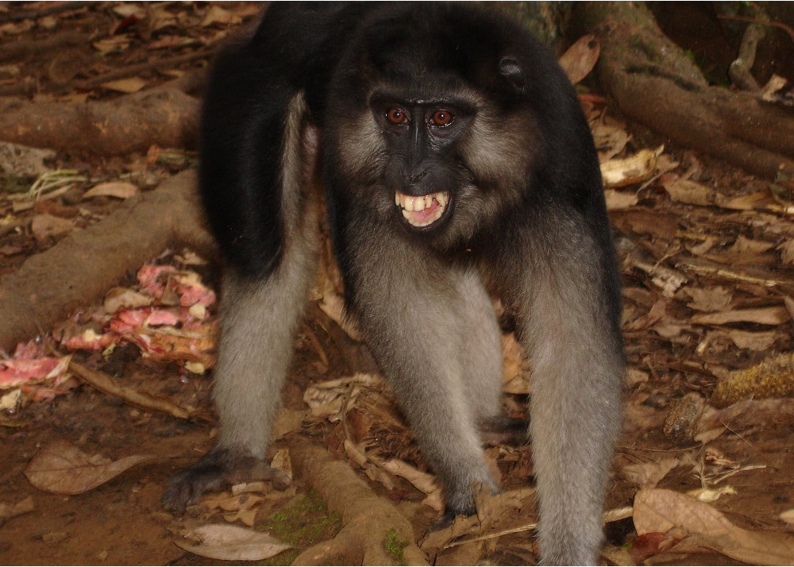
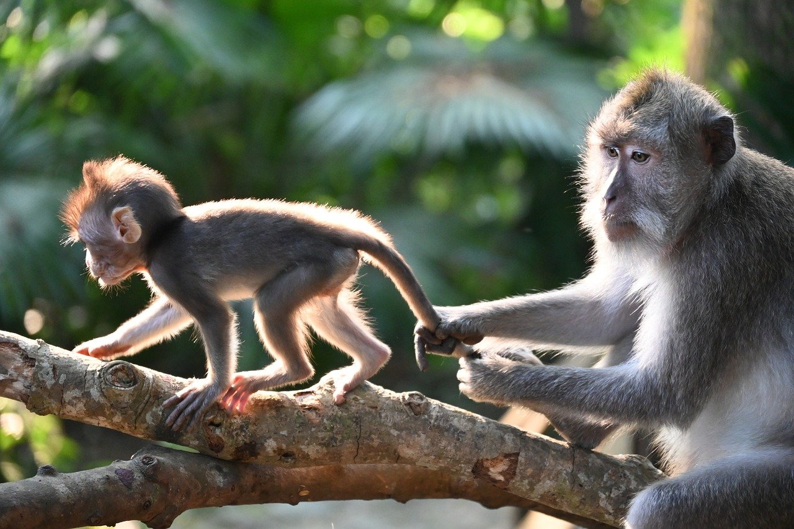
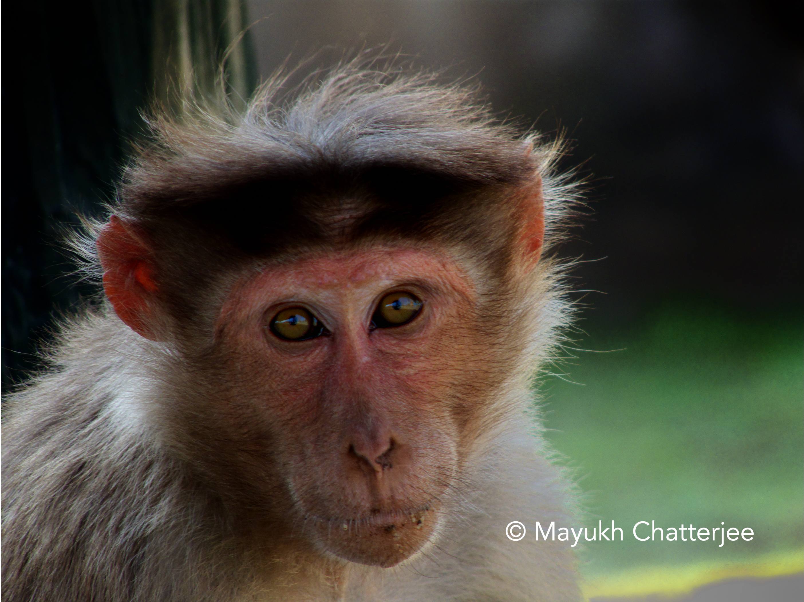

<!-- Section -->
<section>
	<header class="major">
		<h2>Projects</h2>
	</header>
	

		<article>
			
			<h3>Socio-Ecological Drivers of Social Relationships</h3>
			
This study focuses on the socio-ecological forces that shape variation in social relationships in macaques.

			<ul class="actions">
				<li><a href="{{ 'drivers' | absolute_url }}" class="button">Learn more</a></li>
			</ul>
		</article>
		<article>
			
			<h3>Linking Social Diversity & Complexity</h3>
			
This study explores the link between social diversity and social complexity in macaques.

			<ul class="actions">
				<li><a href="{{ 'diversity' | absolute_url }}" class="button">Learn more</a></li>
			</ul>
		</article>
		<article>
			
			<h3>Rank-Related Fitness Benefits & Hierarchy Steepness In Primates</h3>
			
This study investigates the relationship between the steepness of the hierarchy and the skew of the distribution of resources.

			<ul class="actions">
				<li><a href="{{ 'steepness' | absolute_url }}" class="button">Learn more</a></li>
			</ul>
		</article>
		<article>
			
			<h3>Predicting Pathogen Spread Across Mammals</h3>
			
This study utilises trait data, machine learning and spectral graph theory to construct models for predicting infectious disease spread in mammals.

			<ul class="actions">
				<li><a href="{{ 'pathogens' | absolute_url }}" class="button">Learn more</a></li>
			</ul>
		</article>
		<article>
			
			<h3>Social Support, Inequality, And Their Effects On Mortality Across Macaca Species</h3>
			
This study investigates how sociality influences mortality across macaque species and populations, providing insights into life-history evolution and the evolutionary and ecological forces that shape variation in lifespan.

			<ul class="actions">
				<li><a href="{{ 'mortality' | absolute_url }}" class="button">Learn more</a></li>
			</ul>
		</article>
		<article>
			
			<h3>Data Digitizing & Processing</h3>
			
We are looking for volunteers to help digitize or process one or more behavioural macaque datasets. Whether you are a student, early-career researcher, or just looking for a meaningful side project, this is a fantastic opportunity to gain experience working with large, real-world datasets.

			<ul class="actions">
				<li><a href="{{ 'data_digitizing' | absolute_url }}" class="button">Learn more</a></li>
			</ul>
		</article>
	

</section>

<!-- Section -->
<section>
	<header class="major">
		<h2>Want to learn more about macaques and our MacaqueNet database?</h2>
	</header>
	

		<article>
			
			<h3>Macaque Species</h3>
			
Click "Find Out More" to learn about macaques and play our fun quiz to find out which macaque species aligns with your personality best. Go on, you know you want to!

			<ul class="actions">
				<li><a href="{{ 'macaque_species' | absolute_url }}" class="button">Find Out More</a></li>
			</ul>
		</article>
		<article>
			
			<h3>The Database</h3>
			
Want to find out more about the MacaqueNet database? Click the button below to learn how to access and contribute to our ever-growing database.

			<ul class="actions">
				<li><a href="{{ 'database' | absolute_url }}" class="button">Find Out More</a></li>
			</ul>
		</article>
	

</section>
***

 

